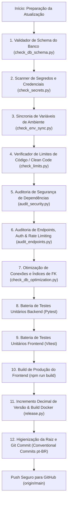

# 🚀 Automações e Validações Pré-Push / Pré-Release (GitHub)

Este documento descreve detalhadamente todas as **automações, verificadores de integridade, scripts de segurança e testes** executados no projeto antes de qualquer envio de atualização ao repositório GitHub (`https://github.com/aryarajalves/area-de-membros.git`).

---

## 📌 Visão Geral do Fluxo Pré-Push

Antes de commitar e subir alterações para a branch `main`, o projeto conta com uma esteira rigorosa de **10 etapas automatizadas** que impedem quebras em produção, vazamentos de credenciais, regressões visuais/lógicas ou falhas de segurança.



---

## 🛠️ Detalhamento de Cada Automação

### 1. 🔍 Verificador de Esquema de Banco de Dados (`scripts/check_db_schema.py`)
- **Objetivo:** Garantir que 100% dos modelos SQLAlchemy (`backend/app/models/*.py`) estejam sincronizados com o bloco de inicialização automática (`lifespan` em `backend/app/main.py`).
- **O que faz:**
  - Extrai todas as tabelas e colunas dos modelos Python.
  - Varre as declarações SQL `CREATE TABLE IF NOT EXISTS` e `ALTER TABLE ... ADD COLUMN IF NOT EXISTS` do `main.py`.
  - Compara ambos os lados e detecta tabelas ou colunas esquecidas.
  - Se houver divergência, gera automaticamente o código SQL pronto para inserção no `main.py` e bloqueia a release.
- **Comando manual:**
  ```bash
  python scripts/check_db_schema.py
  ```

---

### 2. 🔐 Scanner de Segredos e Credenciais (`scripts/check_secrets.py`)
- **Objetivo:** Evitar vazamento acidental de chaves de API, senhas e certificados privados no histórico do Git.
- **O que faz:**
  - Varre todos os arquivos rastreados pelo repositório.
  - Busca padrões regex de chaves reais:
    - OpenAI API Keys (`sk-proj-...`)
    - GitHub Personal Access Tokens (`ghp_...`)
    - Chaves privadas RSA/OpenSSL
    - Brevo API Keys reais (`xkeysib-...`)
    - AWS Access Keys (`AKIA...`)
    - Slack Webhooks
  - Bloqueia commits se arquivos `.env` com dados sensíveis estiverem staged para o Git.
  - Mascara qualquer segredo impresso no terminal (`sk-****1234`).
- **Comando manual:**
  ```bash
  python scripts/check_secrets.py
  ```

---

### 3. ⚙️ Sincronizador de Variáveis de Ambiente (`scripts/check_env_sync.py`)
- **Objetivo:** Garantir a portabilidade do sistema para qualquer novo servidor ou ambiente de homologação/produção.
- **O que faz:**
  - Faz um scanner estático em todos os arquivos `.py` do backend procurando chamadas a `os.getenv("VAR")` e `os.environ.get("VAR")`.
  - Lê o arquivo `backend/.env.example`.
  - Verifica se todas as variáveis utilizadas no código estão presentes e documentadas no `.env.example`.
  - Se faltar alguma variável, lista exatamente as pendências e interrompe o fluxo.
- **Comando manual:**
  ```bash
  python scripts/check_env_sync.py
  ```

---

### 4. 📏 Validador de Limites de Código / Clean Code (`scripts/check_limits.py`)
- **Objetivo:** Prevenir a criação de arquivos monolíticos, assegurando manutenibilidade e modularização contínua.
- **Regras estritas:**
  - **Backend (Python):** Máximo de **1.000 linhas** por arquivo.
  - **Frontend (React/JSX/CSS):** Máximo de **500 linhas** por arquivo.
- **O que faz:**
  - Varre recursivamente `frontend/src` e `backend`.
  - Lista os arquivos ordenados pela quantidade de linhas.
  - Acusa imediatamente qualquer arquivo que ultrapasse o teto permitido para que seja modularizado antes do push.
- **Comando manual:**
  ```bash
  python scripts/check_limits.py
  ```

---

### 5. 🛡️ Auditoria Unificada de Segurança de Dependências (`scripts/audit_security.py`)
- **Objetivo:** Garantir que nenhuma biblioteca com vulnerabilidades conhecidas (CVEs) suba para o repositório ou imagens Docker.
- **O que faz:**
  - **Backend:** Executa `pip-audit` contra o `backend/requirements.txt` com ambiente UTF-8 configurado. Exige **0 vulnerabilidades críticas**.
  - **Frontend:** Executa `npm audit` dentro de `frontend/`. Exige **0 vulnerabilidades**.
  - Se qualquer dependência apresentar falha de segurança, o push é **terminantemente bloqueado** até que o pacote seja atualizado ou mitigado.
- **Comando manual:**
  ```bash
  python scripts/audit_security.py
  ```

---

### 6. 🌐 Auditoria de Endpoints, Autenticação e Rate Limiting (`scripts/audit_endpoints.py`)
- **Objetivo:** Garantir resiliência, proteção contra abusos e documentação completa da API REST FastAPI.
- **O que faz:**
  - Varre os roteadores da API (`backend/app/api/v1/endpoints/`).
  - **Documentação OpenAPI:** Verifica se cada endpoint possui declaração de `summary` e docstring legível.
  - **Autorização/Segurança:** Confere se as rotas privadas exigem injeção de autenticação (`get_current_user`, `require_role`, `verify_api_key`), isentando apenas rotas de mídia estática devidamente categorizadas.
  - **Proteção contra DoS:** Exige decorador de rate limiting `@limiter.limit(...)` via SlowAPI com recebimento obrigatório de `request: Request`.
- **Comando manual:**
  ```bash
  python scripts/audit_endpoints.py
  ```

---

### 7. ⚡ Auditoria de Otimização de Conexões e Banco de Dados (`scripts/check_db_optimization.py`)
- **Objetivo:** Garantir alta performance relacional sob alto tráfego e prevenir exaustão de conexões, vazamento de sessões ou Full Table Scans.
- **O que faz:**
  - **1/4 - Connection Pooling:** Confere parâmetros de robustez do engine SQLAlchemy (`DB_POOL_SIZE=30`, `DB_MAX_OVERFLOW=50`, `DB_POOL_RECYCLE=1800s`, `pool_pre_ping=True` para eliminar conexões fantasmas e timeout de conexão seguro).
  - **2/4 - Índices em Chaves Estrangeiras (ForeignKeys):** Varre 100% dos modelos (111 ForeignKeys declaradas) e assegura que **100% delas possuam índices explícitos** (`index=True` ou compondo índice composto). Chaves sem índice causam `Seq Scan` (Full Table Scan) durante operações de `JOIN` e exclusões em cascata.
  - **3/4 - Vazamento de Sessões (Session Leaks):** Varre todo o código do backend procurando chamadas manuais a `SessionLocal()` fora do ciclo do FastAPI e garante que possuem fechamento estrito em blocos `try/finally: db.close()` ou context managers `with SessionLocal()`.
  - **4/4 - Prevenção de Consultas N+1 (Eager Loading):** Assegura que consultas de listagem com relacionamentos complexos utilizem `joinedload` ou `selectinload` em vez de lazy loading repetitivo.
- **Comando manual:**
  ```bash
  python scripts/check_db_optimization.py
  ```

---

### 8. 🧪 Bateria de Testes Unitários Automatizados
- **Objetivo:** Garantir ausência total de bugs funcionais e regressões antes do commit.
- **Backend (Pytest):**
  - Executado dentro do container da aplicação ou ambiente local:
    ```bash
    docker exec area_de_membros_backend pytest -q --tb=short tests/
    ```
  - Cobre rotas, autenticação, webhooks, serviços de comunidade, feed social, stories, DMs de chat e regras financeiras.
- **Frontend (Vitest):**
  - Executado dentro do diretório `frontend/`:
    ```bash
    npm test -- --run --no-file-parallelism
    ```
  - Cobre componentes React, formulários, modais, hooks customizados e interações de interface.

---

### 8. 📦 Build de Produção do Frontend
- **Objetivo:** Gerar o bundle compilado e otimizado para o Nginx.
- **O que faz:**
  - Executa `npm run build` na pasta `frontend/`.
  - Valida tipagens, sintaxe JSX e gera os assets finais em `frontend/dist`.
  - Como o container `area_de_membros_frontend` serve diretamente `frontend/dist`, o build garante que o ambiente de produção reflita fielmente o código novo.

---

### 9. 🔢 Versionamento Semântico Decimal e Build Docker (`scripts/release.py`)
- **Objetivo:** Orquestrar todas as 8 etapas anteriores em um comando único e gerenciar a numeração de versão e as imagens Docker.
- **Regra de Versão Decimal (Base 10):**
  - Formato `X.Y.Z`:
    - Incrementa `Z` de 1 em 1.
    - Se `Z > 9`, `Z = 0` e incrementa `Y`.
    - Se `Y > 9`, `Y = 0` e incrementa `X`.
    - *Exemplos:* `1.2.7` ➔ `1.2.8` ➔ `1.2.9` ➔ `1.3.0` ➔ `2.0.0`.
- **Atualização Automática de Arquivos:**
  - `frontend/package.json`
  - `docker/.env.producao.example`
  - `docker/docker-compose-producao.yml`
  - `README.md`
- **Regra Rígida de Tags Docker:**
  - **PROIBIDO usar tag `:latest`**.
  - As tags são sempre imutáveis: `backend-X.Y.Z` e `frontend-X.Y.Z`.
- **Comandos de execução:**
  ```bash
  # Execução completa da esteira (validações + testes + build de imagens):
  python scripts/release.py

  # Simulação (dry-run) para testar validações sem gerar imagens pesadas:
  python scripts/release.py --dry-run

  # Especificar uma versão manual:
  python scripts/release.py --version 1.2.9
  ```

---

### 10. 🧹 Limpeza de Arquivos Temporários na Raiz
- **Objetivo:** Manter o repositório limpo, leve e sem arquivos de diagnóstico soltos.
- **Arquivos deletados automaticamente antes do commit:**
  - Screenshots de teste: `screenshot*.png`, `fixed_layout_*.png`, `modal_saved_*.png`
  - Logs de navegadores e processos: `chrome_*.log`, `chrome_err.log`, `*.log` soltos na raiz
  - Bancos SQLite temporários: `test_*.db`, `zapvoice.db`
- **Arquivos protegidos (NUNCA deletados):**
  - Códigos-fonte (`.py`, `.jsx`, `.js`, `.css`), testes unitários e o validador de raiz `verify_system.py`.

---

### 11. 📝 Padrão Obrigatório de Commits (Conventional Commits em pt-BR)
- **Formato:** `<tipo>: <descrição curta em português>`
- **Tipos aceitos:**
  - `feat:` Nova funcionalidade
  - `fix:` Correção de bug
  - `chore:` Atualizações de infraestrutura, deps ou tarefas de manutenção
  - `refactor:` Refatoração sem mudança de comportamento
  - `style:` Ajustes cosméticos / CSS
  - `docs:` Alterações em documentação
  - `test:` Adição ou atualização de testes
- **Idioma obrigatório:** Português do Brasil.
- **Regras:**
  - Letras minúsculas no título, sem ponto final no fim.
  - Máximo de 72 caracteres no título.
  - Manter o `README.md` atualizado com o histórico da versão corrente antes de subir o commit.

---

## 📋 Resumo dos Comandos em Tabela

| Etapa | Script / Comando | Responsabilidade Principal | Bloqueia Release? |
|---|---|---|:---:|
| **1. Banco de Dados** | `python scripts/check_db_schema.py` | Checar sincronia Models SQLAlchemy vs `main.py` | Sim |
| **2. Segredos** | `python scripts/check_secrets.py` | Detectar chaves de API, senhas e tokens reais | Sim |
| **3. Variáveis** | `python scripts/check_env_sync.py` | Garantir que `os.getenv` está no `.env.example` | Sim |
| **4. Clean Code** | `python scripts/check_limits.py` | Checar teto de linhas (Backend: 1000, Frontend: 500) | Sim |
| **5. Dependências** | `python scripts/audit_security.py` | `pip-audit` e `npm audit` (0 vulnerabilidades) | Sim |
| **6. APIs / Endpoints** | `python scripts/audit_endpoints.py` | Documentação, Autenticação e Rate Limiting | Sim |
| **7. Testes Backend** | `pytest tests/` | Validação funcional de regras e endpoints | Sim |
| **8. Testes Frontend** | `npm test -- --run` | Validação de componentes e hooks Vitest | Sim |
| **9. Frontend Build** | `npm run build` | Compilar versão final do Nginx (`frontend/dist`) | Sim |
| **10. Esteira Completa** | `python scripts/release.py` | Executa todas as etapas e gera imagens Docker | Sim |

---

*Documentação mantida e atualizada para garantir 100% de confiabilidade, rastreabilidade e segurança nos deploys do sistema.*
